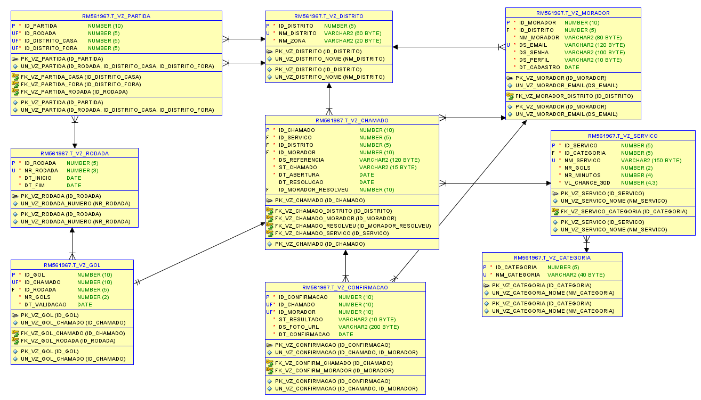

# Várzea: o campeonato dos bairros

**Global Solution 2026.2 · Database Design**

**Equipe:** Várzea
**Solução:** Várzea

**Integrantes, em ordem alfabética:**

- Gabriel Santos - RM 562419
- Gustavo Rocha - RM 564152
- Thiago Nascimento - RM 561967
- Vinicius Herreira - RM 565662

---

## Sumário

1. Objetivo e escopo do projeto
2. Principais funcionalidades
3. Modelo de dados
4. Scripts entregues

---

## 1. Objetivo e escopo do projeto

Em São Paulo, moradores pedem o conserto de buracos, sarjetas, calçadas e bueiros, mas cobrar a cidade é uma tarefa lenta e solitária. A **Várzea** transforma essa cobrança em um campeonato entre distritos: cada problema resolvido e confirmado por vizinhos vale gol, e os problemas mais difíceis valem mais.

O banco de dados organiza as informações do jogo, para apoiar a decisão de onde agir e mostrar o desempenho de cada distrito.

**Dentro do escopo:** distritos, serviços e categorias, moradores, chamados, confirmações dos vizinhos, gols, rodadas e partidas.

**Fora do escopo:** integração automática com o SP156, patrocínio, itens de torcida e equipes da subprefeitura.

**Origem dos dados de exemplo:** nomes de distritos e serviços e as chances de resolução em 30 dias vêm do SP156, da Prefeitura de São Paulo. Moradores, referências, fotos e chamados são fictícios. O tempo de execução dos serviços é uma estimativa da equipe.

## 2. Principais funcionalidades

- **Registrar um problema:** o morador informa o serviço, o distrito e uma referência, sem endereço com número.
- **Acompanhar o chamado:** cada um passa por aberto, em andamento, resolvido ou cancelado.
- **VAR da torcida:** vizinhos confirmam ou contestam a resolução com uma foto, uma vez por chamado.
- **Validar o gol:** um chamado resolvido com pelo menos 2 confirmações vale os gols definidos para o serviço.
- **Campeonato:** rodadas com partidas entre distritos.
- **Consultas de gestão:** chamados resolvidos, desempenho por distrito e chamados que aguardam o VAR.

## 3. Modelo de dados

### Relacionamentos e cardinalidades

| Tabela pai | Tabela filha | Cardinalidade | Significado |
|---|---|---|---|
| T_VZ_CATEGORIA | T_VZ_SERVICO | 1:N | Uma categoria agrupa vários serviços |
| T_VZ_DISTRITO | T_VZ_MORADOR | 1:N | Um distrito tem vários moradores na torcida |
| T_VZ_DISTRITO | T_VZ_CHAMADO | 1:N | Um distrito tem vários chamados |
| T_VZ_SERVICO | T_VZ_CHAMADO | 1:N | Um serviço aparece em vários chamados |
| T_VZ_MORADOR | T_VZ_CHAMADO | 1:N | Um morador abre vários chamados |
| T_VZ_MORADOR | T_VZ_CHAMADO (resolveu) | 0..1:N | Um morador marca vários chamados como resolvidos |
| T_VZ_CHAMADO | T_VZ_CONFIRMACAO | 1:N | Um chamado recebe várias confirmações |
| T_VZ_MORADOR | T_VZ_CONFIRMACAO | 1:N | Um morador faz várias confirmações |
| T_VZ_CHAMADO | T_VZ_GOL | 1:0..1 | Um chamado gera no máximo um gol |
| T_VZ_RODADA | T_VZ_GOL | 1:N | Uma rodada contabiliza vários gols |
| T_VZ_RODADA | T_VZ_PARTIDA | 1:N | Uma rodada tem várias partidas |
| T_VZ_DISTRITO | T_VZ_PARTIDA (casa) | 1:N | Um distrito joga várias partidas em casa |
| T_VZ_DISTRITO | T_VZ_PARTIDA (fora) | 1:N | Um distrito joga várias partidas fora |

### Regras que ficam na aplicação

Estas regras dependem de mais de uma linha ou tabela, então a API deve garanti-las. Os dados de exemplo as respeitam:

- Um gol exige pelo menos 2 confirmações.
- O morador não confirma o próprio chamado.
- O valor do gol é igual ao do serviço.

## 4. Scripts entregues

| Arquivo | Conteúdo |
|---|---|
| `00_apagar.sql` | Apaga só as tabelas da Várzea, para recriar o banco |
| `01_ddl.sql` | 9 tabelas, todas as constraints e as sequências da API |
| `02_dml.sql` | Pelo menos 5 linhas por tabela |
| `03_dql.sql` | As três consultas pedidas |
