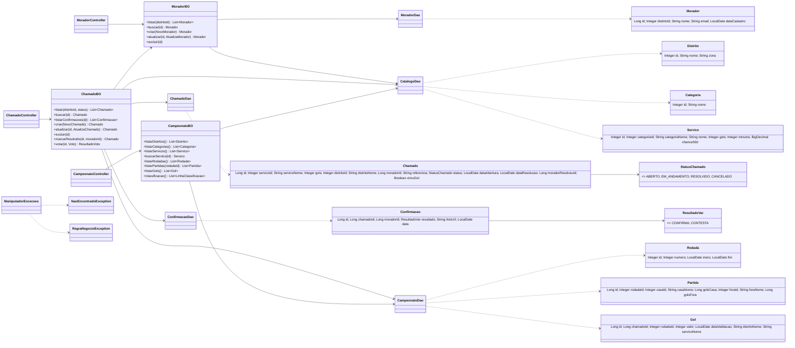

# Várzea: API REST

**Global Solution 2026.2 · Domain Driven Design - Java**

**Integrantes:**

- [Nome completo] - RM [00000]
- [Nome completo] - RM [00000]
- [Nome completo] - RM [00000]
- [Nome completo] - RM [00000]
- [Nome completo] - RM [00000]

---

## Índice

1. Descritivo da solução, justificativa e objetivos
2. Diagrama de classes
3. Protótipos de tela
4. Endpoints
5. Diagrama Entidade-Relacionamento
6. Como executar

---

## 1. Descritivo da solução, justificativa e objetivos

**Solução.** A Várzea é um campeonato entre distritos de São Paulo. Um morador relata um problema da rua, outro informa que foi resolvido, e dois vizinhos confirmam com foto. Só então o conserto vira gol para o distrito. Esta API implementa essa regra central.

**Justificativa.** Cobrar a cidade é uma tarefa lenta e solitária, e fechar um chamado não prova que o problema foi resolvido. Em 104.604 chamados de rua do SP156 no último trimestre de 2025, 88,1% foram finalizados em até 30 dias, mas apenas 33,6% dos pedidos de guias e sarjetas.

**Objetivos.**

- Registrar moradores e chamados de cada distrito.
- Validar a resolução com o VAR da torcida.
- Calcular gols, placares e classificação.
- Impedir fraudes: quem relatou ou marcou como resolvido não vota, e só vizinhos do distrito participam.

## 2. Diagrama de classes

> Exportar como imagem para o PDF, por exemplo em [mermaid.live](https://mermaid.live).



## 3. Protótipos de tela

> Inserir capturas de https://varzea-flame.vercel.app: início, abertura de chamado, VAR, gol marcado e tabela.

O MVP publicado usa Supabase. As telas mostram o fluxo que esta API implementa com o Oracle.

## 4. Endpoints

Base: `https://[link-do-render]/api`

| Método | Rota | Descrição | Sucesso |
|---|---|---|---|
| GET | `/status` | Situação da API e do banco | 200 |
| GET | `/distritos` | Lista os distritos | 200 |
| GET | `/categorias` | Lista as categorias | 200 |
| GET | `/servicos` | Lista os serviços e seus gols | 200 |
| GET | `/servicos/{id}` | Busca um serviço | 200 |
| GET | `/rodadas` | Lista as rodadas | 200 |
| GET | `/rodadas/{id}/partidas` | Partidas e placares da rodada | 200 |
| GET | `/gols` | Lista os gols validados | 200 |
| GET | `/classificacao` | Classificação por gols | 200 |
| GET | `/moradores?distritoId=` | Lista os moradores | 200 |
| GET | `/moradores/{id}` | Busca um morador | 200 |
| POST | `/moradores` | Cria um morador | 201 |
| PUT | `/moradores/{id}` | Atualiza nome e e-mail | 200 |
| DELETE | `/moradores/{id}` | Exclui um morador sem histórico | 204 |
| GET | `/chamados?distritoId=&status=` | Lista até 100 chamados | 200 |
| GET | `/chamados/{id}` | Busca um chamado | 200 |
| POST | `/chamados` | Abre um chamado | 201 |
| PUT | `/chamados/{id}` | Edita um chamado aberto | 200 |
| DELETE | `/chamados/{id}` | Exclui um chamado aberto | 204 |
| POST | `/chamados/{id}/resolver` | Marca como resolvido | 200 |
| GET | `/chamados/{id}/confirmacoes` | Lista os votos do VAR | 200 |
| POST | `/chamados/{id}/confirmacoes` | Registra um voto do VAR | 200 |

**Erros:** `400` dados inválidos, `404` não encontrado, `405` método não permitido, `409` conflito com dados registrados, `422` regra do jogo violada, `503` banco indisponível. Todos respondem em JSON:

```json
{ "momento": "2026-11-05T20:00:00", "status": 422, "mensagem": "Você já votou neste chamado.", "detalhes": [] }
```

**Exemplo de voto:**

```json
{ "moradorId": 3, "resultado": "CONFIRMA", "fotoUrl": "https://example.com/fotos/rua.jpg" }
```

Resposta, com `desfecho` igual a `AGUARDANDO`, `GOL` ou `ANULADO`:

```json
{ "desfecho": "GOL", "confirmacoes": 2, "contestacoes": 0, "golsMarcados": 8 }
```

**Limite conhecido:** a API não tem login, e o morador é informado na requisição. Em produção, ele viria de um token autenticado.

## 5. Diagrama Entidade-Relacionamento

> Usar a mesma imagem exportada do Oracle Data Modeler na entrega de Database.

Tabelas: `T_VZ_DISTRITO`, `T_VZ_CATEGORIA`, `T_VZ_SERVICO`, `T_VZ_MORADOR`, `T_VZ_RODADA`, `T_VZ_PARTIDA`, `T_VZ_CHAMADO`, `T_VZ_CONFIRMACAO` e `T_VZ_GOL`.

## 6. Como executar

**Ferramentas:** IntelliJ IDEA, Java JDK 21, Maven 3.9 e Oracle Database da FIAP.

**Links:**

- GitHub: [link]
- Deploy: [link do Render]

**Passo a passo:**

1. Execute no Oracle da FIAP os arquivos `database/01_ddl.sql` e `database/02_dml.sql`.
2. Clone o repositório e abra a pasta `java-api` no IntelliJ.
3. Defina as variáveis de ambiente `ORACLE_USER` e `ORACLE_PASSWORD`. Se necessário, defina também `ORACLE_URL`.
4. Execute a classe `VarzeaApplication`.
5. Acesse `http://localhost:8080/api/status`. A resposta deve trazer `"banco":"conectado"`.

**Testes:** execute `mvn test`. Eles usam H2 em modo Oracle e não precisam de credenciais.
