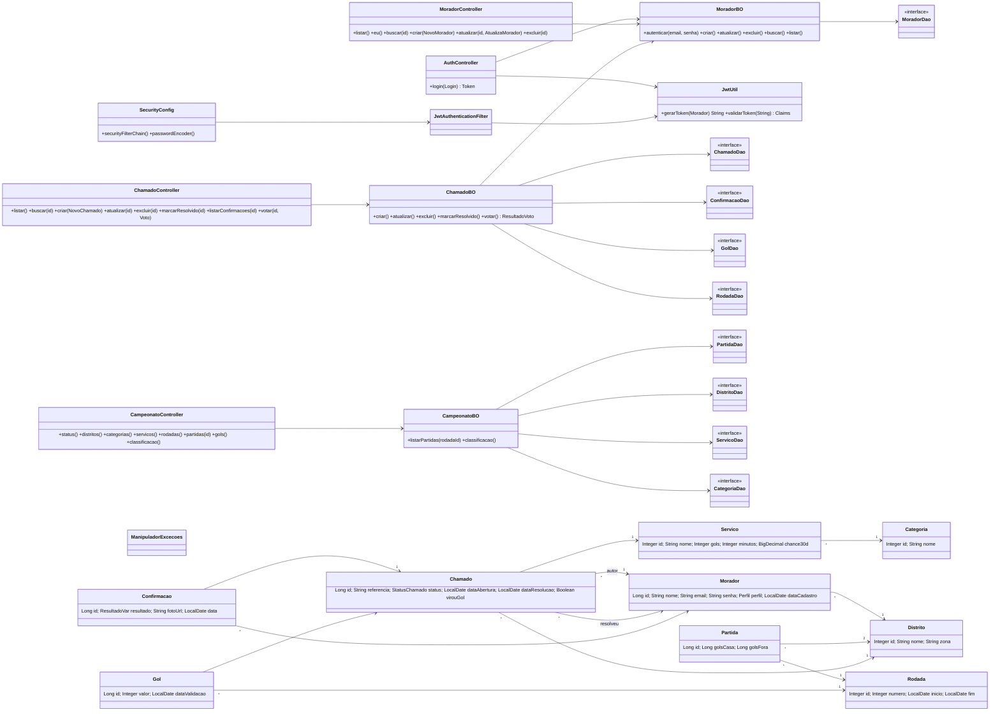

# Várzea: API REST

**Global Solution 2026.2 · Domain Driven Design - Java**

**Integrantes:**

- [Nome completo] - RM [00000]
- [Nome completo] - RM [00000]
- [Nome completo] - RM [00000]
- [Nome completo] - RM [00000]
- [Nome completo] - RM [00000]

---

## Índice

1. Descritivo da solução, justificativa e objetivos
2. Arquitetura e diagrama de classes
3. Protótipos de tela
4. Endpoints
5. Diagrama Entidade-Relacionamento
6. Como executar

---

## 1. Descritivo da solução, justificativa e objetivos

**Solução.** A Várzea é uma auditoria cidadã dos consertos da cidade, em forma de campeonato entre distritos. Um morador relata um problema da rua, outro informa que foi resolvido, e dois vizinhos conferem no local e confirmam com foto. Só então o conserto vira gol para o distrito. Esta API implementa essa regra central.

**Justificativa.** Fechar um chamado não prova que o problema foi resolvido. Em 104.604 chamados de rua do SP156 no último trimestre de 2025, 88,1% foram finalizados em até 30 dias, mas apenas 33,6% dos pedidos de guias e sarjetas.

**Objetivos.**

- Registrar moradores e chamados de cada distrito, com login seguro.
- Validar a resolução com o VAR da torcida.
- Calcular gols, placares e classificação.
- Impedir fraudes: quem relatou ou marcou como resolvido não vota, e só vizinhos do distrito participam.

## 2. Arquitetura e diagrama de classes

A API segue as camadas vistas em aula, com Spring Data JPA, Bean Validation e Spring Security com JWT:

| Camada | Pacote | Papel |
|---|---|---|
| Modelo | `model` | Entidades JPA (`@Entity`) mapeadas para as tabelas `T_VZ_*` |
| DAO | `dao` | Interfaces `JpaRepository` com query methods |
| BO | `bo` | Regras de negócio (`@Service`) |
| Controller | `controller` | Endpoints REST, com `@Valid` e `@PreAuthorize` |
| Exceções | `exception` | `@RestControllerAdvice` com respostas JSON padronizadas |
| Segurança | `security` | `SecurityFilterChain`, filtro JWT e senhas com BCrypt |

> Exportar o diagrama abaixo como imagem para o PDF, por exemplo em [mermaid.live](https://mermaid.live).



## 3. Protótipos de tela

> Inserir capturas de https://varzea-flame.vercel.app: início, abertura de chamado, VAR, gol marcado e tabela.

O MVP publicado usa Supabase. As telas mostram o fluxo que esta API implementa com o Oracle.

## 4. Endpoints

Base: `https://varzea-api.onrender.com/api`

As rotas marcadas como **token** exigem o cabeçalho `Authorization: Bearer <token>`, obtido no login.

| Método | Rota | Acesso | Descrição | Sucesso |
|---|---|---|---|---|
| POST | `/auth/login` | Público | Login com e-mail e senha; devolve o token JWT | 200 |
| GET | `/status` | Público | Situação da API e do banco | 200 |
| GET | `/distritos` | Público | Lista os distritos | 200 |
| GET | `/categorias` | Público | Lista as categorias | 200 |
| GET | `/servicos` | Público | Lista os serviços e seus gols | 200 |
| GET | `/servicos/{id}` | Público | Busca um serviço | 200 |
| GET | `/rodadas` | Público | Lista as rodadas | 200 |
| GET | `/rodadas/{id}/partidas` | Público | Partidas e placares da rodada | 200 |
| GET | `/gols` | Público | Lista os gols validados | 200 |
| GET | `/classificacao` | Público | Classificação por gols | 200 |
| POST | `/moradores` | Público | Cadastro; todo novo morador entra como USER | 201 |
| GET | `/moradores?distritoId=` | ADMIN | Lista os moradores | 200 |
| GET | `/moradores/eu` | Token | Dados de quem está logado | 200 |
| GET | `/moradores/{id}` | Próprio ou ADMIN | Busca um morador | 200 |
| PUT | `/moradores/{id}` | Próprio ou ADMIN | Atualiza nome e e-mail | 200 |
| DELETE | `/moradores/{id}` | ADMIN | Exclui um morador sem histórico | 204 |
| GET | `/chamados?distritoId=&status=` | Token | Lista até 100 chamados | 200 |
| GET | `/chamados/{id}` | Token | Busca um chamado | 200 |
| POST | `/chamados` | Token | Abre um chamado no distrito de quem está logado | 201 |
| PUT | `/chamados/{id}` | Autor ou ADMIN | Edita um chamado aberto | 200 |
| DELETE | `/chamados/{id}` | Autor ou ADMIN | Exclui um chamado aberto | 204 |
| POST | `/chamados/{id}/resolver` | Token | Marca como resolvido | 200 |
| GET | `/chamados/{id}/confirmacoes` | Token | Lista os votos do VAR | 200 |
| POST | `/chamados/{id}/confirmacoes` | Token | Registra um voto do VAR | 200 |

**Erros:** `400` dados inválidos, `401` sem login ou token inválido, `403` sem permissão, `404` não encontrado, `405` método não permitido, `409` conflito com dados registrados, `422` regra do jogo violada, `503` banco indisponível. Todos respondem em JSON:

```json
{ "timestamp": "2026-11-11T20:00:00", "status": 400, "mensagem": "Dados inválidos.", "errors": ["A referência deve ter de 5 a 120 caracteres."] }
```

**Exemplo de login:**

```json
{ "email": "bruno.exemplo@example.com", "senha": "varzea123" }
```

Resposta:

```json
{ "token": "eyJ...", "tipo": "Bearer", "moradorId": 2, "perfil": "USER" }
```

**Exemplo de voto**, com o morador identificado pelo token:

```json
{ "resultado": "CONFIRMA", "fotoUrl": "https://example.com/fotos/rua.jpg" }
```

Resposta, com `desfecho` igual a `AGUARDANDO`, `GOL` ou `ANULADO`:

```json
{ "desfecho": "GOL", "confirmacoes": 2, "contestacoes": 0, "golsMarcados": 8 }
```

**Usuários de demonstração:** os moradores de exemplo usam a senha `varzea123` e têm perfil USER. A conta ADMIN é `ana.ficticia@example.com`, e a senha dela é entregue apenas ao professor.

## 5. Diagrama Entidade-Relacionamento

> Usar a mesma imagem exportada do Oracle Data Modeler na entrega de Database.

Tabelas: `T_VZ_DISTRITO`, `T_VZ_CATEGORIA`, `T_VZ_SERVICO`, `T_VZ_MORADOR`, `T_VZ_RODADA`, `T_VZ_PARTIDA`, `T_VZ_CHAMADO`, `T_VZ_CONFIRMACAO` e `T_VZ_GOL`.

## 6. Como executar

**Ferramentas:** IntelliJ IDEA, Java JDK 21 ou superior, Maven 3.9 (ou o `mvnw` do projeto) e Oracle Database da FIAP.

**Links:**

- GitHub: https://github.com/thns7/varzea
- Deploy: https://varzea-api.onrender.com/api/status

**Passo a passo:**

1. No Oracle da FIAP, execute `database/00_apagar.sql` (só se as tabelas já existirem), depois `database/01_ddl.sql` e `database/02_dml.sql`.
2. Clone o repositório e abra a pasta `java-api` no IntelliJ.
3. Defina as variáveis de ambiente `ORACLE_USER`, `ORACLE_PASSWORD` e `JWT_SEGREDO` (texto aleatório com pelo menos 32 caracteres).
4. Execute a classe `VarzeaApplication`.
5. Acesse `http://localhost:8080/api/status`. A resposta deve trazer `"banco":"conectado"`.
6. Faça login em `POST /api/auth/login` e use o token nas rotas protegidas, por exemplo no Postman.

**Testes:** execute `mvn test`. São 9 testes de ponta a ponta com H2 em modo Oracle, que não precisam de credenciais.
